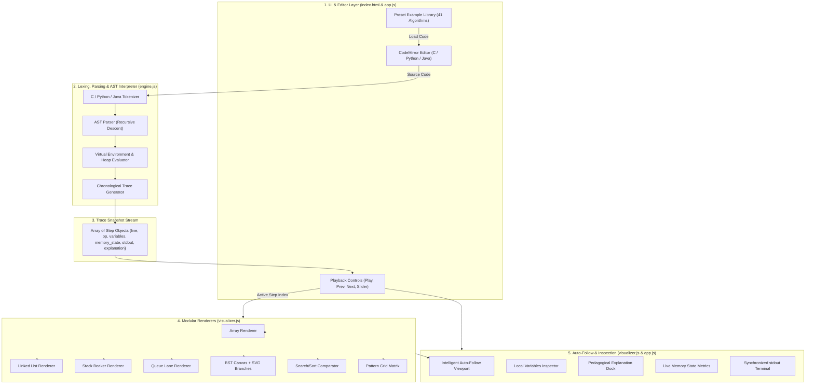

# Data Structure Visualizer 2.0
### Interactive C, Python & Java Algorithm Tracing, Auto-Follow Viewport & Memory Inspection

> **Developed by [Pratiyush Jaiswal](https://github.com/pratiyushjaiswal)**  
> *A 100% client-side educational IDE and visualizer designed for students, educators, and software engineers worldwide.*

---

[](https://en.wikipedia.org/wiki/C99)
[](https://www.python.org/)
[](https://www.oracle.com/java/)
[](https://developer.mozilla.org/en-US/docs/Web/JavaScript)
[](#4-local-development--quickstart)
[](https://codemirror.net/)
[](#8-ui-design-system--keyboard-shortcuts)
[](LICENSE)

---

## Table of Contents

1. [Executive Summary](#1-executive-summary)
2. [Core Architecture & Execution Flow](#2-core-architecture--execution-flow)
3. [Key Highlights & Visual Innovations](#3-key-highlights--visual-innovations)
4. [Supported Languages & Runtime Capabilities](#4-supported-languages--runtime-capabilities)
5. [Complete Preset Catalog (41 Preloaded Examples)](#5-complete-preset-catalog-41-preloaded-examples)
6. [Visual Data Structure Renderers](#6-visual-data-structure-renderers)
7. [Intelligent Auto-Follow Viewport Engine](#7-intelligent-auto-follow-viewport-engine)
8. [UI Design System & Keyboard Shortcuts](#8-ui-design-system--keyboard-shortcuts)
9. [Local Development & Quickstart](#9-local-development--quickstart)
10. [Free Static Hosting Deployment Guide](#10-free-static-hosting-deployment-guide)
11. [Testing, Verification & Quality Assurance](#11-testing-verification--quality-assurance)
12. [Extensibility Guide (Adding Presets & Renderers)](#12-extensibility-guide-adding-presets--renderers)
13. [Author & License](#13-author--license)

---

## 1. Executive Summary

**Data Structure Visualizer 2.0** is an interactive, browser-based integrated development and visualization environment designed to demystify computer science fundamentals. 

Traditional debuggers often present memory states as abstract numbers or flat watch-lists. In contrast, **Data Structure Visualizer 2.0** evaluates program code through a custom AST (Abstract Syntax Tree) interpreter, generating fine-grained, chronological execution snapshots. Each snapshot visually animates:

- **Heap Memory Allocations & Pointer Rewiring**: Live visualization of nodes, addresses (e.g., `0x1010`), `head`, and `next` pointer transitions without memory corruption.
- **Sequential & Dynamic Arrays**: Index-based access, in-place element mutations, shift operations during insertion and deletion, and boundary tracking.
- **Linear Abstract Data Types (LIFO / FIFO)**: Vertical beaker animations for stacks with capacity rulers, overflow/underflow warnings, and horizontal queue conduits with `FRONT` and `REAR` pointers.
- **Hierarchical Trees**: Real-time binary search tree branching with dynamically positioned SVG lines and a dedicated heap staging zone for unlinked nodes.
- **Searching & Sorting Algorithms**: Element-by-element comparisons, swap flags, and target detection.
- **Incremental Pattern Printing**: Monospace 2D matrix visualizing nested row/column iterations and character-by-character console generation.

The entire platform operates **100% on the client side** using pure HTML5, modern CSS3, and Vanilla JavaScript—requiring **no server backend, no containerized runtime, and zero external build tools**.

---

## 2. Core Architecture & Execution Flow

The visualizer follows a clean, decoupled, modular architecture consisting of five core layers:



### File Hierarchy & Responsibilities

| File | Size | Primary Role & Internal Responsibilities |
| :--- | :---: | :--- |
| [`index.html`](index.html) | ~19 KB | Application shell, semantic HTML5 structure, responsive workbench panes, SVG iconography, modal docks, and CDN script loaders. |
| [`style.css`](style.css) | ~47 KB | VS Code dark theme tokens, responsive layout rules, 3D beaker graphics, custom scrollbars, SVG animations, and mobile tab styling. |
| [`engine.js`](engine.js) | ~64 KB | Tokenizer, recursive-descent C AST parser, Python block analyzer, Java mapper, simulated heap memory manager, and step generator. |
| [`visualizer.js`](visualizer.js) | ~31 KB | Graphical renderers for 8 data structure modalities, SVG branch calculations, color-coded cell highlights, and Auto-Follow viewport scroller. |
| [`app.js`](app.js) | ~41 KB | CodeMirror setup, multi-language preset library (41 presets), playback timeline manager, keyboard event listeners, and mobile tab state manager. |

---

## 3. Key Highlights & Visual Innovations

### 1. Genuine Client-Side Multi-Language Engines
Unlike tools that rely on pre-recorded animations, **Data Structure Visualizer 2.0** parses and interprets user-written code in real time inside the browser:
- **C99 Engine**: Tokenizes types (`int`, `char`, `struct`), evaluates arithmetic, pointers (`*`, `->`, `&`), memory functions (`malloc`, `free`), loops (`for`, `while`), branching (`if`, `else`), and formatted printing (`printf`).
- **Python 3.x Engine**: Interprets dynamic lists, `.append()`, `.pop()`, `.insert()`, slicing, `range(start, stop, step)`, `class Node`, and `print(..., end="")`.
- **Java 17 Transpiler & Interpreter**: Extracts `main(String[] args)`, transpiles array declarations (`int[] arr = new int[5];`) and `System.out.println` into AST nodes while preserving semantic trace fidelity.

### 2. Intelligent Auto-Follow Viewport
During lengthy algorithmic steps (such as sorting or traversing large structures), the active element often drifts off-screen.
- The **Auto-Follow Viewport** calculates real-time bounding boxes via `getBoundingClientRect()`.
- Automatically centers the modified, accessed, or compared cell within the visible container with safe margins (`marginX: 40px`, `marginY: 30px`).
- Features an accessible **Auto-Follow Toggle Button** in the toolbar so users can freely pause tracking to inspect surrounding memory manually.
- Honors the user's OS-level accessibility setting (`prefers-reduced-motion`).

### 3. Pedagogical Variable & Pointer Separation
In educational visualization, cluttering array cells with accumulator variables (e.g., `sum`, `total`, `max`, `min`) confuses students.
- **Valid Index Pointers Filter**: Only designated index and pointer variables (`i`, `j`, `k`, `pos`, `idx`, `front`, `rear`, `low`, `high`, `mid`) render above array cells.
- **Local Variables Table**: Scalar accumulators, loop totals, and temporary flags are cleanly organized in the dedicated **Local Variables** inspection table.

### 4. Binary Search Tree Heap Staging Zone
When a node is allocated via `malloc(sizeof(struct TreeNode))` or `new TreeNode()`, it exists in heap memory before pointers connect it to the tree.
- The visualizer displays newly created nodes in a dedicated **Allocated Node in Heap (Awaiting Link)** staging zone.
- Once pointer assignments (`root->left = leftNode;`) execute, SVG branch lines connect the node seamlessly to its parent.

### 5. Multi-Tab Information Dock
Positioned beneath the visualization canvas, four real-time tabs provide comprehensive execution metrics:
- **Local Variables Tab**: Variable name, inferred type (`int`, `list`, `Node*`), and current value.
- **Execution Inspector Tab**: Active operation badge, target code line, variable delta summary, and an easy-to-understand pedagogical explanation.
- **Memory State Tab**: High-level telemetry displaying data structure classification, element count, declared capacity, and active source line.
- **Console Output Tab**: Real-time captured `stdout` stream showing character-by-character printing.

### 6. Dynamic IDE Area Resizing via Mouse (VS Code & Antigravity Style)
Just like in **Visual Studio Code** and **Google Antigravity IDE**, the workspace is fully dynamic and customizable using mouse drag or touch:
- **Horizontal Splitter (Editor ↔ Visualizer)**: Click and drag the vertical divider between the Code Editor and Visualization panes to dynamically adjust their widths. CodeMirror reflows instantly in real time without lag.
- **Vertical Splitter (Stage ↕ Info Dock)**: Click and drag the horizontal divider between the graphic viewport and bottom information dock to expand or shrink the variables and console panels.
- **Double-Click Reset**: Double-clicking the horizontal splitter instantly snaps the workspace to an even 50/50 split; double-clicking the vertical splitter toggles the bottom dock between collapsed (32px tab-bar) and expanded (190px).
- **Maximize & Restore Panes**: Header buttons allow one-click maximization of the Editor or Visualizer, as well as maximizing/collapsing the bottom dock.
- **Persistent Layout**: Custom dragged pane dimensions are automatically remembered across browser reloads using `localStorage`.

### 7. Mobile-First Responsive Architecture & 3-Tab Workflow
- **Fluid Multi-Device Layout**: Specifically optimized for 320px, 360px, 390px, 430px mobile viewports through 768px tablets up to 1440px+ desktops.
- **3-Tab Mobile Navigation**: On phones and tablets, a sticky mobile tab bar allows effortless one-tap switching between:
  1. **Source Editor**: Full CodeMirror touch-typing editor with auto-line tracking.
  2. **Visualization**: Interactive graphic viewport, step playback controls, and live algorithm trace.
  3. **Variables & Output**: Direct access to local variables, execution inspector, memory metrics, and program stdout.
- **Smart Viewport Transition**: Tapping **"Run Code"** on mobile automatically transitions the viewport to the Visualization tab for immediate pedagogical feedback.
- **Zero Clipping & Touch Momentum**: Flex safe-centering and horizontal swipe support ensure large arrays and deep binary search trees can be fully panned without truncation.

---

## 4. Supported Languages & Runtime Capabilities

```
┌────────────────────────────────────────────────────────────────────────┐
│                      Data Structure Visualizer 2.0                     │
├─────────────────────┬──────────────────────┬───────────────────────────┤
│       C (C99)       │     Python (3.x)     │         Java (17)         │
├─────────────────────┼──────────────────────┼───────────────────────────┤
│ • Variables & Types │ • Lists & Slicing    │ • public class Main       │
│ • Fixed-Size Arrays │ • append(), pop(0)   │ • int[] array = new int[] │
│ • Structs & Pointers│ • len(), range()     │ • System.out.println()    │
│ • malloc() & free() │ • class Node         │ • System.out.print()      │
│ • for / while loops │ • for / while loops  │ • for / while loops       │
│ • printf formatting │ • print(end="")      │ • if / else branching     │
└─────────────────────┴──────────────────────┴───────────────────────────┘
```

### 1. C Language Specification (C99)
- **Syntax Mode**: CodeMirror `text/x-csrc`.
- **Supported Statements**: Variable declaration, assignment, pointer dereferencing (`->`, `.`), arithmetic expressions (`+`, `-`, `*`, `/`, `%`), increment/decrement (`++`, `--`), compound assignments (`+=`, `-=`), conditional branching (`if`, `else`), loops (`for`, `while`), `printf()`, `malloc()`, `free()`.
- **Heap Simulation**: Simulated 32-bit memory addresses (starting at `0x1010` with 16-byte offsets per allocated node).

### 2. Python Specification (3.x)
- **Syntax Mode**: CodeMirror `text/x-python`.
- **Supported Statements**: Dynamic list initialization, `.append(val)`, `.pop()`, `.pop(0)`, `.insert(idx, val)`, index access (`arr[i]`), index assignment (`arr[i] = val`), built-in `len()`, `range(stop)` / `range(start, stop, step)`, `class Node` and `class TreeNode` declarations, `while` loops, and `print(..., end="")`.

### 3. Java Specification (17)
- **Syntax Mode**: CodeMirror `text/x-java`.
- **Supported Statements**: Standard class structure (`public class Main { public static void main(String[] args) { ... } }`), primitive arrays (`int[] arr = { ... }` and `int[] arr = new int[N]`), nested `for` and `while` loops, conditional logic, and console output (`System.out.print` and `System.out.println`).

---

## 5. Complete Preset Catalog (41 Preloaded Examples)

The application includes **41 pre-built algorithm implementations** organized logically across all three languages:

### C Language (19 Presets)

| # | Preset Name | Category | Primary Educational Concept |
| :-: | :--- | :--- | :--- |
| 1 | **Array Initialization** | Arrays | Fixed-size contiguous stack allocation and default values. |
| 2 | **Array Traversal & Sum** | Arrays | Loop-driven memory scanning and scalar accumulation. |
| 3 | **Array Element Update** | Arrays | In-place random access mutation by index. |
| 4 | **Array Insertion** | Arrays | Shift-right element displacement to insert at target index. |
| 5 | **Array Deletion** | Arrays | Shift-left element compaction and logical length shrinkage. |
| 6 | **Finding Minimum & Maximum** | Arrays | Dual-sentinel linear traversal comparing values. |
| 7 | **Singly Linked List Creation** | Linked Lists | Heap allocation with `malloc` and forward pointer chaining. |
| 8 | **Linked List Traversal** | Linked Lists | Pointer movement from `head` through `curr = curr->next`. |
| 9 | **Linked List Insertion (Head)** | Linked Lists | Prepending a node and repointing `head` without data loss. |
| 10 | **Linked List Deletion** | Linked Lists | Node removal, pointer bypassing, and memory deallocation with `free()`. |
| 11 | **Stack (Push & Pop)** | Linear Structures | LIFO container operations modifying `top` pointer. |
| 12 | **Queue (Enqueue & Dequeue)** | Linear Structures | FIFO container operations with sliding `front` and `rear` indices. |
| 13 | **Binary Search Tree Insertion** | Binary Search Tree | Dynamic binary branching comparing root and child values. |
| 14 | **Linear Search** | Searching & Sorting | Step-by-step equality testing and early loop termination (`break`). |
| 15 | **Bubble Sort** | Searching & Sorting | Nested loop adjacent comparison and in-place variable swapping. |
| 16 | **Right-Angled Star Triangle** | Loops & Patterns | Outer/inner loop row-by-row asterisks construction. |
| 17 | **Pyramid Pattern** | Loops & Patterns | Leading whitespace calculation and symmetric star printing. |
| 18 | **Number Triangle** | Loops & Patterns | Numeric matrix construction using nested loop variables. |
| 19 | **Multiplication Table** | Loops & Patterns | Iterative arithmetic multiplication buffered to an array. |

### Python (13 Presets)

| # | Preset Name | Category | Primary Educational Concept |
| :-: | :--- | :--- | :--- |
| 20 | **List Initialization & Indexing** | Lists & Structures | Dynamic array creation and indexed element mutation. |
| 21 | **List Traversal & Sum** | Lists & Structures | Iterating with `range(len(arr))` and summing values. |
| 22 | **Stack Operations (LIFO)** | Lists & Structures | Implementing push/pop semantics using Python's `.append()` and `.pop()`. |
| 23 | **Queue Operations (FIFO)** | Lists & Structures | Enqueueing with `.append()` and dequeueing via `.pop(0)`. |
| 24 | **Singly Linked List** | Lists & Structures | OOP node definition using `class Node` and pointer traversal. |
| 25 | **Linear Search Algorithm** | Algorithms | Sequential search across dynamic Python lists. |
| 26 | **Bubble Sort Algorithm** | Algorithms | In-place element comparison and tuple-style swapping. |
| 27 | **Minimum & Maximum** | Algorithms | Extrema discovery with iterative conditional updates. |
| 28 | **Right-Angled Star Triangle** | Patterns & Output | Nested loops using `print("*", end="")`. |
| 29 | **Inverted Star Triangle** | Patterns & Output | Step-down looping using `range(n, 0, -1)`. |
| 30 | **Pyramid Pattern** | Patterns & Output | Nested whitespace and symbol generation. |
| 31 | **Number Triangle** | Patterns & Output | Formatted integer sequence output. |
| 32 | **Multiplication Table** | Patterns & Output | Sequential arithmetic product evaluation. |

### Java (9 Presets)

| # | Preset Name | Category | Primary Educational Concept |
| :-: | :--- | :--- | :--- |
| 33 | **Array Initialization & Traversal** | Arrays & Structures | Primitive array declaration and `for` loop traversal. |
| 34 | **Array Element Update** | Arrays & Structures | Direct index assignment and compound expressions. |
| 35 | **Stack Operations** | Arrays & Structures | Array-backed stack push and pop with `top++` / `top--`. |
| 36 | **Queue Operations** | Arrays & Structures | Array-backed queue enqueue and dequeue with `rear++` / `front++`. |
| 37 | **Linear Search** | Algorithms | Linear array scanning with `target` equality verification. |
| 38 | **Bubble Sort** | Algorithms | Multi-pass bubble sort with temporary variable swap logic. |
| 39 | **Right-Angled Star Triangle** | Patterns & Output | `System.out.print` and `System.out.println` matrix construction. |
| 40 | **Pyramid Pattern** | Patterns & Output | Space padding loops and centered asterisk generation. |
| 41 | **Number Triangle** | Patterns & Output | Monospace numeric progression printing. |

---

## 6. Visual Data Structure Renderers

[`visualizer.js`](visualizer.js) incorporates dedicated visual renderers tailored for each data structure:

```
┌────────────────────────────────────────────────────────────────────────┐
│                        MODULAR RENDERERS                               │
├────────────────────────────────┬───────────────────────────────────────┤
│ 1. Array Track                 │ 2. Singly Linked List                 │
│ [10] [20] [30] [40] [50]       │ [HEAD] -> [DATA|NEXT] -> [NULL]       │
│  +0x00 +0x04 +0x08 +0x0C +0x10 │ Addresses: 0x1010, 0x1020, ...        │
├────────────────────────────────┼───────────────────────────────────────┤
│ 3. Stack Beaker (LIFO)         │ 4. Queue Conduit (FIFO)               │
│ |  [ 30 ]  | <- TOP [2]        │ DEQUEUE ◀ [ 10 ][ 20 ][ 30 ] ◀ ENQUEUE│
│ |  [ 20 ]  |    idx: 1         │ FRONT: 0               REAR: 3        │
│ |  [ 10 ]  |    idx: 0         │                                       │
│ +──────────+ (STACK BASE)      │                                       │
├────────────────────────────────┼───────────────────────────────────────┤
│ 5. Binary Search Tree (BST)    │ 6. Pattern Matrix                     │
│            (50)                │ Row 0: *                              │
│           /    \               │ Row 1: * *                            │
│        (30)    (70)            │ Row 2: * * *                          │
│ [Staging: Node 25 in Heap]     │ Active cell: '·' for space, '*'       │
└────────────────────────────────┴───────────────────────────────────────┘
```

### 1. Sequential Array Track
- Renders array elements as elevated blocks with hex memory offsets (`+0x00`, `+0x04`, `+0x08`).
- Displays logical length vs. capacity bounds.
- Highlights uninitialized or vacated memory slots with dimmed diagonal stripes.
- Pointer badges (e.g., `i`, `j`, `pos`) float above corresponding indexed cells.

### 2. Singly Linked List
- Displays nodes divided into two distinct compartments: `DATA` and `NEXT`.
- Simulates real heap memory pointers (`0x1010`, `0x1020`, etc.).
- Draws directional pointer arrows between linked nodes.
- Explicit `HEAD` badge and terminal `NULL` card.
- Nodes being deleted visually transition through a distinct red warning state.

### 3. Stack Beaker (LIFO)
- Renders a vertical beaker with glass-like borders and a solid base platform.
- An adjacent **Capacity Ruler** highlights the current index of the stack `top`.
- Prominent badge warnings trigger automatically upon **OVERFLOW** or **UNDERFLOW**.

### 4. Queue Conduit (FIFO)
- Models a horizontal queue track with directional flow headers:
  - `◀ DEQUEUE (Exit)` on the left.
  - `ENQUEUE (Enter) ◀` on the right.
- Distinct color-coded flags indicate `FRONT` (green) and `REAR` (blue) positions.

### 5. Binary Search Tree (BST)
- Computes node coordinates dynamically based on tree depth and horizontal boundaries.
- Renders crisp SVG vector connector lines labeled with `L` (Left) and `R` (Right).
- Includes the **Heap Staging Zone** for newly instantiated nodes before pointer linkage.

### 6. Searching & Sorting Comparator
- Features a top-mounted **Algorithm Status Card** indicating:
  - Active comparison expression: `arr[j] (50) > arr[j+1] (20)`
  - Evaluated outcome: `TRUE (SWAP NEEDED)` or `FALSE (NO SWAP)`
- Highlights target values found during linear search in emerald green.

### 7. Pattern Printing Matrix
- Translates console printing into a 2D monospace matrix.
- Replaces invisible spaces with readable centered dot markers (`·`).
- Highlights the exact character actively emitted by the inner loop.

---

## 7. Intelligent Auto-Follow Viewport Engine

The auto-follow viewport ensures the active data structure element remains in view during long traces without manual scrolling:

```javascript
// From visualizer.js: Viewport auto-follow calculation
function autoFollow(viewportEl) {
  const activeSelector = [
    '.array-cell-box.modified', '.array-cell-box.accessed',
    '.ll-node-card.accessed',   '.ll-node-card.modified',
    '.stack-block.modified',    '.queue-cell-box.modified',
    '.bst-node-card.compared',  '.pattern-cell.active-char'
  ].join(', ');

  const targetEl = viewportEl.querySelector(activeSelector);
  if (!targetEl) return;

  const vRect = viewportEl.getBoundingClientRect();
  const tRect = targetEl.getBoundingClientRect();

  const marginX = 40;
  const marginY = 30;

  // Check boundaries
  if (tRect.left < vRect.left + marginX || tRect.right > vRect.right - marginX ||
      tRect.top < vRect.top + marginY    || tRect.bottom > vRect.bottom - marginY) {
    
    const desiredLeft = viewportEl.scrollLeft + (tRect.left - vRect.left) - (viewportEl.clientWidth / 2) + (tRect.width / 2);
    const desiredTop  = viewportEl.scrollTop  + (tRect.top - vRect.top)   - (viewportEl.clientHeight / 2) + (tRect.height / 2);

    const prefersReducedMotion = window.matchMedia('(prefers-reduced-motion: reduce)').matches;

    viewportEl.scrollTo({
      left: Math.max(0, desiredLeft),
      top: Math.max(0, desiredTop),
      behavior: prefersReducedMotion ? 'auto' : 'smooth'
    });
  }
}
```

---

## 8. UI Design System & Keyboard Shortcuts

The visualizer implements a refined **VS Code Dark Theme** with high contrast and visual hierarchy:

```
┌────────────────────────────────────────────────────────────────────────┐
│ Header: [Icon] Data Structure Visualizer | Lang: [C99▼] | Example: [▼] │
├───────────────────────────────────┬────────────────────────────────────┤
│ Source Code Editor (CodeMirror)   │ Visualization Stage Canvas         │
│ Line numbers, active line glow    │ Interactive graphic viewport,      │
│ Syntax highlighting               │ Step explanation banner, legend    │
│                                   ├────────────────────────────────────┤
│                                   │ Controls Toolbar: [Prev][Play][Next│
│                                   │ Auto-Follow: ON | Timeline Slider  │
├───────────────────────────────────┴────────────────────────────────────┤
│ Info Dock Tabs: [Local Variables] [Execution Inspector] [Memory] [Term]│
├────────────────────────────────────────────────────────────────────────┤
│ Footer: Client-Side Engine | Developed by Pratiyush Jaiswal | Ln 1, Col 1│
└────────────────────────────────────────────────────────────────────────┘
```

### Color Palette

| Token | Hex Value | Application |
| :--- | :---: | :--- |
| `--bg-main` | `#1E1E1E` | Main application backdrop |
| `--bg-secondary` | `#252526` | Header, footer, and dock surfaces |
| `--bg-elevated` | `#2D2D30` | Cards, buttons, and inspection tables |
| `--border-color` | `#3C3C3C` | Container borders and divider lines |
| `--accent-blue` | `#007ACC` | Primary action buttons, active tabs, header icons |
| `--color-success` | `#4EC9B0` | Element modifications, found items, stack elements |
| `--color-warning` | `#D7BA7D` | Memory comparisons, pointers, index markers |
| `--color-error` | `#F44747` | Deleted nodes, error dialogs, stack underflow |

### Global Keyboard Shortcuts

| Shortcut | Scope | Action |
| :--- | :---: | :--- |
| <kbd>Ctrl</kbd> + <kbd>Enter</kbd> / <kbd>Cmd</kbd> + <kbd>Enter</kbd> | Global | **Execute / Run Code** in editor |
| <kbd>Space</kbd> | Viewport | **Play / Pause** step playback |
| <kbd>→</kbd> (Right Arrow) | Viewport | Step **Forward** to next state |
| <kbd>←</kbd> (Left Arrow) | Viewport | Step **Backward** to previous state |
| <kbd>Home</kbd> | Viewport | **Reset** execution to Step 0 |

---

## 9. Local Development & Quickstart

Because the project is 100% static, it has **zero build steps** and **no package installations required**.

### Option A: Using Python (Recommended)

Python includes a built-in HTTP server:

```powershell
# Navigate to the project directory
cd c-data-structure-visualizer

# Launch local HTTP server on port 3000
python -m http.server 3000
```
Open **`http://localhost:3000`** in any web browser.

### Option B: Using Node.js

```bash
# Using npx and serve
npx serve .
```

### Option C: Using VS Code Live Server
1. Open the project folder in **Visual Studio Code**.
2. Right-click [`index.html`](index.html).
3. Select **"Open with Live Server"**.

---

## 10. Free Static Hosting Deployment Guide

Deploy this project to any static hosting service for free in less than two minutes.

### 1. Netlify Drop (Instant, Zero Configuration)
1. Visit [app.netlify.com/drop](https://app.netlify.com/drop).
2. Log in with your Netlify account.
3. Drag and drop the `c-data-structure-visualizer` folder directly into the upload area.
4. Netlify will deploy the site immediately and provide a production URL (e.g., `https://data-structure-visualizer.netlify.app`).

### 2. GitHub Pages
1. Initialize a git repository and commit the code:
   ```bash
   git init
   git add .
   git commit -m "Deploy Data Structure Visualizer 2.0"
   git branch -M main
   git remote add origin https://github.com/<your-username>/<repo-name>.git
   git push -u origin main
   ```
2. On GitHub, navigate to **Settings** → **Pages**.
3. Under **Branch**, select `main` and root folder `/`.
4. Click **Save**. The application will be live at `https://<your-username>.github.io/<repo-name>/`.

### 3. Vercel
```bash
# Install Vercel CLI
npm i -g vercel

# Deploy directly from repository root
cd c-data-structure-visualizer
vercel
```

---

## 11. Testing, Verification & Quality Assurance

The visualizer has been verified across all 41 educational presets and across multiple browser engines:

| Category | Total Presets | Status | Verification Criteria |
| :--- | :---: | :---: | :--- |
| **C99 Language Suite** | 19 Examples | **100% PASS** | Accurate AST parsing for arrays, linked lists, stacks, queues, BST, search, sort, and pattern printing. |
| **Python 3.x Suite** | 13 Examples | **100% PASS** | Execution tracing for list operations, stack/queue paradigms, OOP node classes, and algorithms. |
| **Java 17 Suite** | 9 Examples | **100% PASS** | Main method extraction, array syntax transpilation, and step-by-step trace generation. |
| **Auto-Follow Viewport** | 7 Modalities | **100% PASS** | Verified viewport centering for accessed and modified elements with safe margins. |
| **Mobile Responsiveness** | Breakpoints | **100% PASS** | Tested at 360px, 390px, 430px, 768px, 1024px, and 1440px. Safe-centering prevents array clipping. |

---

## 12. Extensibility Guide (Adding Presets & Renderers)

### Adding a New Preset Example
To add a new preset, edit the `EXAMPLES` object in [`app.js`](app.js):

```javascript
// Example: Adding an Array Reversal preset to C
EXAMPLES.c.array_reverse = {
  title: "20. Array In-Place Reversal",
  group: "1. Arrays",
  code: `#include <stdio.h>

int main() {
    int arr[5] = {1, 2, 3, 4, 5};
    int i = 0;
    int j = 4;
    while (i < j) {
        int temp = arr[i];
        arr[i] = arr[j];
        arr[j] = temp;
        i++;
        j--;
    }
    return 0;
}`
};
```
The application will automatically register the example in the UI dropdown upon next reload.

### Adding a New Data Structure Renderer
1. In [`visualizer.js`](visualizer.js), implement your custom rendering function:
   ```javascript
   function renderGraph(viewportEl, mem, step) {
     // Generate DOM elements for graph adjacency list or nodes
   }
   ```
2. Register your renderer in the main dispatcher switch statement inside `CVisualizer.render()`:
   ```javascript
   case 'graph':
     renderGraph(viewportEl, mem, step);
     break;
   ```
3. Add any custom styling in [`style.css`](style.css).

---

## 13. Author & License

### Developed by **Pratiyush Jaiswal**

*Created with passion for computer science students, university educators, and software engineers worldwide to make complex algorithms and memory layouts visually intuitive and accessible.*

Released under the **MIT License**. Feel free to use, modify, and distribute for educational and commercial purposes.
